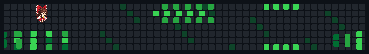

# Matheus Ferreira dos Santos

**Game Developer**  
Gameplay Programming · C# · Game Design

## Selected work

| Project | My contributions | Explore |
| --- | --- | --- |
| **Laggy Garden** | Core gameplay, farming, NPC and enemy AI, progression, UI, save/load and mobile optimization. | [Play](https://play.google.com/store/apps/details?id=com.DreamsGames.LaggyGarden) |
| **The Adventurous MetalCraig** | Gameplay systems, inventory/save-load and UI/UX implementation for a team-built 3D adventure. | [Play](https://bouncybytestudio.itch.io/the-adventurous-metalcraig) |
| **Greedy Diver** | Player systems, AI, scrolling backgrounds, save/load, stores and full UI implementation for an Android diving game. | [Play](https://matara0.itch.io/greedydiver) |

## Tools & focus

**Unity · C# · Git/GitHub · DOTween · Localization · Addressables**

## Let's connect

Open to remote opportunities in game development and game design. For professional opportunities, reach out through [LinkedIn](https://www.linkedin.com/in/matheus-ferreira-dos-santos-787433222/) or [email](mailto:matheusfsantos.152@gmail.com).
